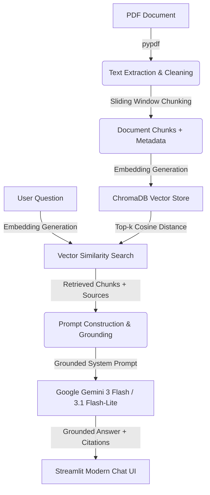

# 🚀 TalkPDF - AI Document Chatbot with RAG

A production-grade, local **Retrieval-Augmented Generation (RAG)** system built with **Python, Streamlit, ChromaDB, and Google Gemini**.

---

## 🌟 Architecture Overview



---

## 🛠️ Tech Stack & Decisions

| Component | Choice | Why in Industry? |
| :--- | :--- | :--- |
| **Frontend UI** | Streamlit | Rapid prototyping, reactive state, clean chat and file upload widgets |
| **PDF Parser** | `pypdf` | Lightweight, native Python, preserves page numbers for source attribution |
| **Chunking** | Custom Recursive/Window | Avoids edge context loss using dynamic overlap |
| **Vector Database** | ChromaDB | Embedded vector database, persistent on disk (`./chroma_db`), zero complex infra required |
| **LLM Provider** | Google Gemini (Free Tier) | Generous rate limits, low latency, factual grounding |

---

## 🚀 Quickstart Guide

### 1. Set Up Environment
```powershell
# Activate virtual environment
.\.venv\Scripts\Activate.ps1

# Install requirements
pip install -r requirements.txt
```

### 2. Configure Gemini API Key
Create a `.env` file or enter your key in the Streamlit UI sidebar:
```env
GEMINI_API_KEY=your_gemini_api_key_here
```
Get a free key from: [Google AI Studio](https://aistudio.google.com/app/apikey)

### 3. Run the Web Application
```powershell
streamlit run app.py
```

---

## 🎯 How to Explain this in an AI Engineer Interview

### 1. "What is RAG and why use it over fine-tuning?"
- **Answer:** Fine-tuning teaches a model a *style or new vocabulary*, but it doesn't give it dynamic access to proprietary or frequently updated knowledge, and it suffers from hallucinations and high training costs.
- **RAG** decouples memory from the model: it retrieves relevant text chunks from a vector database and inserts them into the model's context window at inference time. This guarantees up-to-date knowledge, zero hallucination of private facts, and auditable source citations.

### 2. "Why is chunk size and chunk overlap important?"
- **Small chunks (e.g. 100 tokens):** High semantic precision, but loses broader context.
- **Large chunks (e.g. 2000 tokens):** Dilutes vector embedding specificity and risks context window limits.
- **Overlap (e.g. 100-150 characters):** Ensures that sentences crossing a chunk boundary aren't chopped in half, preserving continuity.

### 3. "How does Vector Search work?"
- Chunks and queries are converted into high-dimensional vectors (dense embeddings).
- Distance metrics (Cosine Similarity or Euclidean Distance) calculate proximity. The top-$k$ nearest neighbors represent the most semantically relevant context.

### 4. "How do you connect this with a MERN stack?"
- The RAG logic can be exposed via a FastAPI or Express.js REST/WebSocket endpoint.
- In Express, you can forward PDF uploads to the ingestion pipeline, query Chroma/Pinecone, and stream the generated response back to a React frontend.
